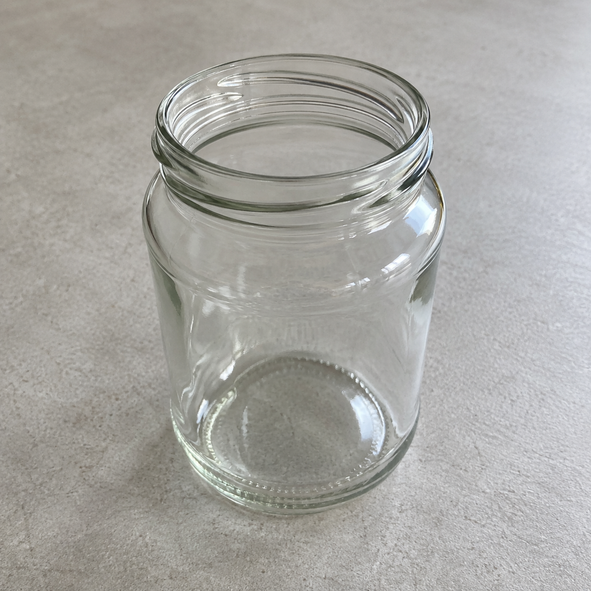
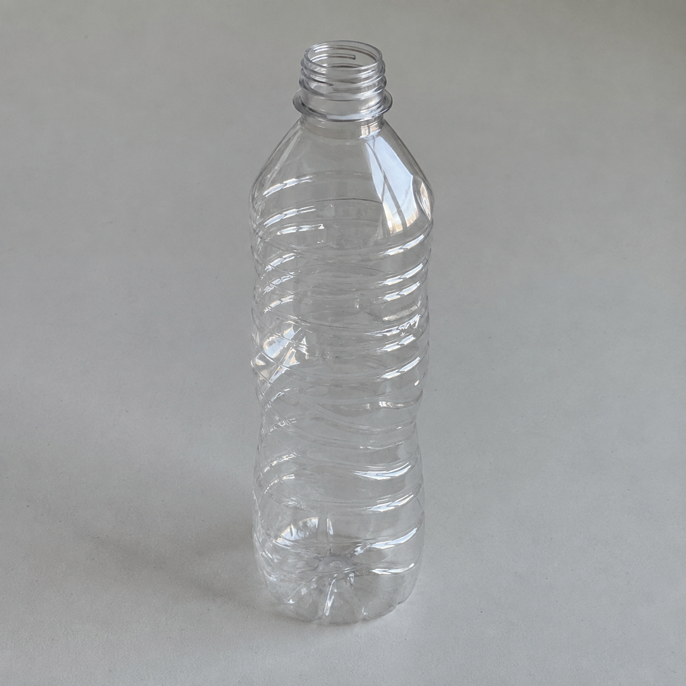
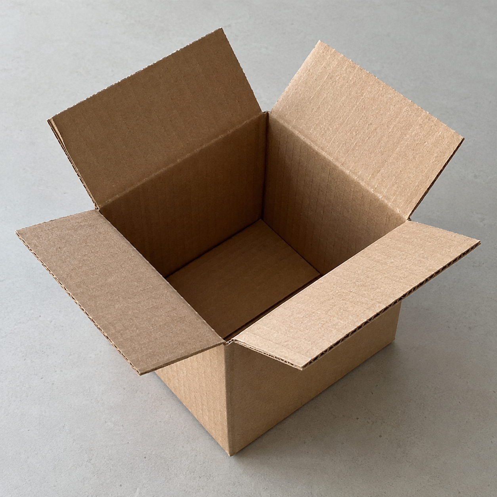
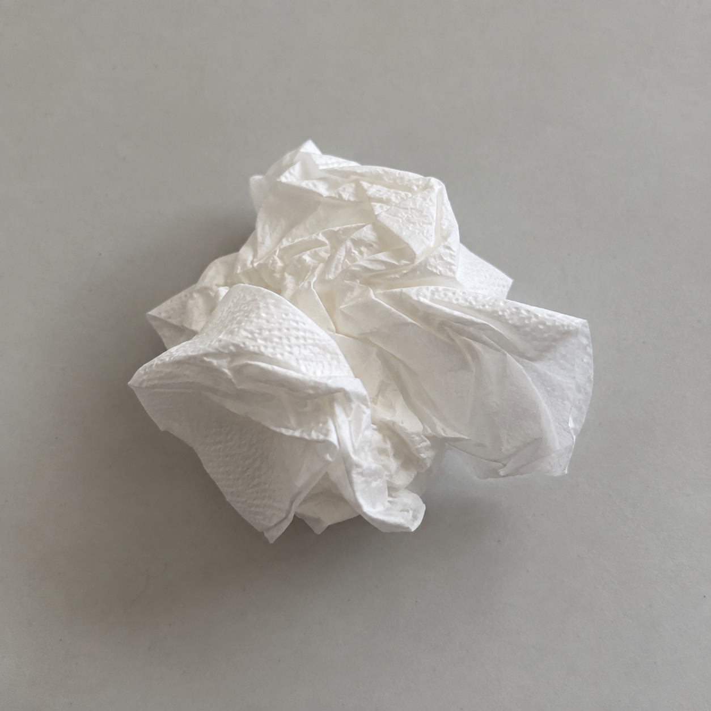
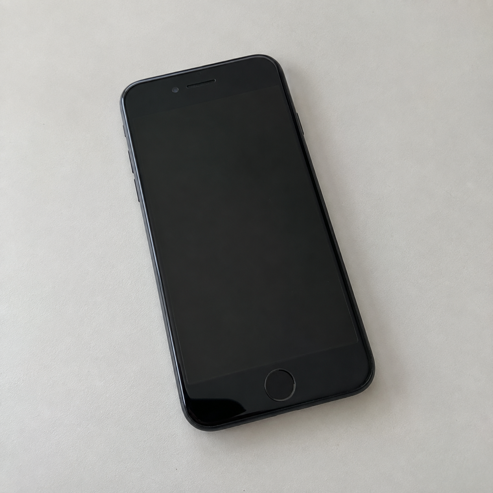
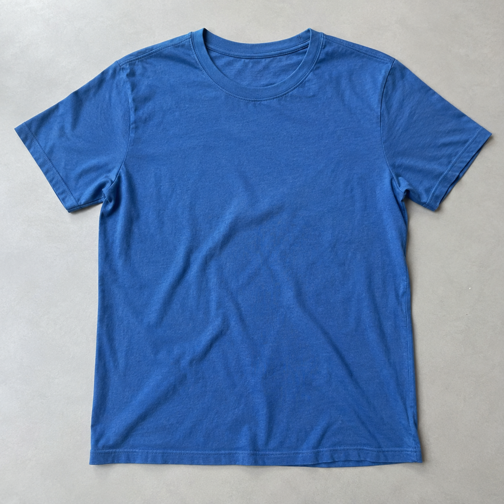

# Synthetic pipeline example images

Created with the built-in image-generation tool on 2026-09-22; no personal photos or external source photographs. Intended for manual demos and integration smoke checks, not an independent model-accuracy benchmark. No app card artwork was changed.

See [test instructions](../../../docs/PIPELINE_TEST_CASES.md) and [case manifest](cases.json).

| Glass | Plastic | Paper |
| --- | --- | --- |
|  |  |  |

| General waste | Electronics | Clothes |
| --- | --- | --- |
|  |  |  |

## Generation prompts and provenance

All six use: “Use case: photorealistic-natural. Asset type: synthetic test image for a recycling app. Subject: [subject below] Natural smartphone-style photograph on a plain pale gray tabletop, soft daylight, square composition, single object fully in frame with clear material texture. No people, hands, text, captions, recycling symbols, or extra objects. Produce one image only.”

- `glass.png`: One empty clear glass food jar without its lid, clean and dry, angled so the empty inside and thick glass rim are visible.
- `plastic.png`: One empty clear disposable PET water bottle, uncapped and label removed, visible plastic ribs and thin slightly dented sides.
- `paper.png`: One small empty plain corrugated cardboard shipping box, open flaps, clean and dry, no tape or labels.
- `general.png`: One crumpled white household facial tissue after ordinary use, no blood, no medical context, no packaging.
- `electronics.png`: One old black smartphone lying face up with its intact dark screen off, no branding, no cables or visible damage.
- `clothes.png`: One plain blue cotton T-shirt laid flat, visibly intact and clean, gentle natural fabric wrinkles, no graphics or tags.

Mode: built-in image generation. Local PNG outputs copied unchanged into `images/`; original generated files retained outside the repository. Exact files, not regeneration, are the repeatable fixtures. The offline provider response is supplied by `cases.json`, not image recognition. Actual live recognition must be checked separately.

Audit storage review (2026-09-22): lossless recompression saved only 28,160 bytes
(about 0.2%). The original files are retained to avoid binary-history churn for a
negligible gain. Material size reduction requires a separate resizing/format decision
and revalidation of the visual benchmark; these fixtures are not unused files.
